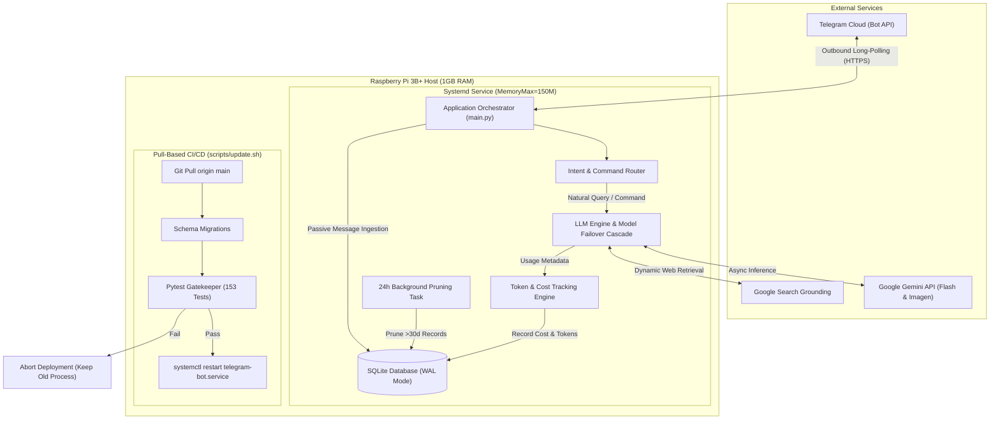
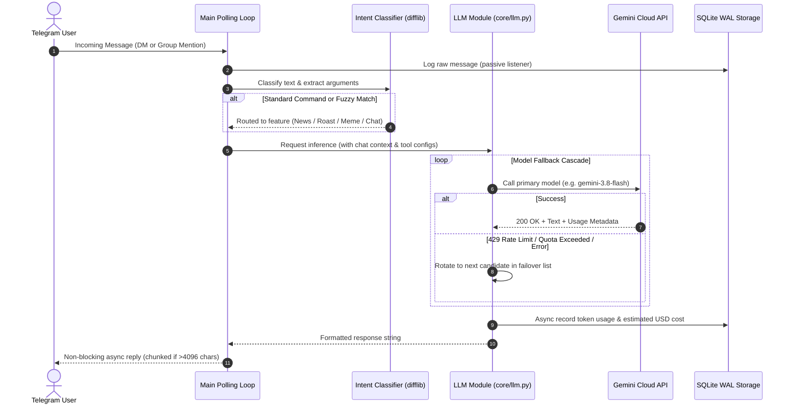

# Edge-Optimized AI Telegram Bot

A production-grade, asynchronous AI assistant engineered for resource-constrained edge computing environments (Raspberry Pi 3B+). Features multi-model Google Gemini LLM orchestration, live Google Search grounding, multimodal image generation, token-level cost accounting, zero-dependency multilingual intent classification, and an automated test-gated CI/CD pipeline.

[](https://www.python.org/)
[](https://python-telegram-bot.org/)
[](https://github.com/)
[](https://pytest.org/)
[](LICENSE)

---

## Technical Summary for Engineering Portfolios

This project demonstrates the design and deployment of a resilient, full-stack edge AI service operating 24/7 on constrained ARM hardware under strict network isolation. It highlights practical trade-offs in systems programming, asynchronous event loops, LLM cost management, and automated operational pipelines.

### Key Engineering Achievements

- **Edge Resource Optimization:** Engineered to run comfortably inside an active resident footprint of approximately **53 MB RAM** (~5.7% of host capacity on a 1 GB Raspberry Pi 3B+), staying well below the systemd enforcement ceiling of **150 MB RAM**. Zero swap thrashing safeguards MicroSD flash endurance.
- **Asynchronous Event-Driven Core:** Fully non-blocking event-driven pipeline leveraging `python-telegram-bot` (v20+ async) and `asyncio`. Heavy file and database interactions run via dedicated worker thread pools (`asyncio.to_thread`) to prevent blocking the primary Telegram dispatch loop.
- **Multi-Model LLM Resilience & Cascading Failover:** Built on the official `google-genai` SDK with an automated fallback cascade across multiple Gemini Flash models (`gemini-3.8-flash`, `gemini-3.5-flash`, `gemini-3.5-flash-lite`, and latest aliases) to smoothly handle rate limits, transient provider errors, and quota exhaustion without user disruption.
- **Multimodal Generation ("Nano Banana" Engine):** Dynamic image generation and editing using Google's lightweight image models (`gemini-3.1-flash-lite-image`, `gemini-2.5-flash-image`, `gemini-3-pro-image`) with automatic priority failover ordered from lowest to highest per-image cost.
- **Search Grounding with Automatic Degradation:** Integrates real-time Google Search Grounding for dynamic news digests. Dynamically detects API quota exhaustion (HTTP 429) and falls back cleanly to internal knowledge synthesis without crashing.
- **Zero-Dependency Multilingual Intent Classifier:** Custom intent recognition supporting Ukrainian, Russian, and English with typo-tolerant fuzzy matching implemented via Python's standard library `difflib`. Routes natural language queries to distinct features without loading multi-hundred-megabyte NLP weights into memory.
- **FinOps & Token Telemetry:** Real-time tracking of prompt tokens, completion tokens, call frequencies, and estimated USD expenditure logged into SQLite. Exposes live financial analytics via an owner-only `/stats` command.
- **Low-Overhead Persistent Storage (SQLite WAL):** Local persistence utilizing Write-Ahead Logging (`PRAGMA journal_mode = WAL`) for concurrent read/write performance. Includes an automated non-blocking 24-hour background task that prunes chat records past the 30-day retention window.
- **Strict Dorm Firewall Traversal:** Runs behind an isolated university campus network with inbound client isolation. All traffic operates over outbound HTTPS long-polling (`Application.run_polling()`). Remote administration is conducted securely via a private Tailscale Mesh VPN.
- **Test-Gated Pull-Based CI/CD:** Production updates trigger a two-tier pull-based deployment pipeline (`scripts/update.sh` -> `scripts/deploy.sh`) equipped with a bash `ERR` trap. Before reloading the systemd service, the entire test suite (153 unit tests with 100% offline mocking) must pass, guaranteeing zero-downtime regression prevention.

---

## Architectural Overview



### Request Flow and Fallback Logic



---

## Technical Specifications & Performance Metrics

| Dimension | Specification / Metric | Engineering Rationale |
| :--- | :--- | :--- |
| **Target Hardware** | Raspberry Pi 3B+ (Quad-core ARM Cortex-A53 @ 1.4 GHz, 1 GB RAM) | Extreme edge compute baseline; validates efficiency. |
| **Operating System** | Debian GNU/Linux (Bookworm) 64-bit / Raspberry Pi OS Lite | Headless minimal installation; no X11 or desktop overhead. |
| **Process Memory (RSS)** | **~53 MB** resident memory (~5.7% of system RAM) | Handcrafted light imports; zero bulky runtime dependencies. |
| **Enforced Memory Ceiling**| `MemoryMax=150M`, `MemoryHigh=120M` (via systemd cgroups) | Guarantees the OS and kernel never experience OOM panics. |
| **Swap Usage** | **0 MB** (Zero swap utilization) | Protects MicroSD card against flash endurance degradation. |
| **CPU Usage** | < 1% idle, < 15% peak during active generation | Offloads compute-heavy inference to cloud API via async I/O. |
| **Database Engine** | SQLite 3 (`bot_memory.db`) with Write-Ahead Logging (`WAL`) | Near-zero RAM footprint, crash-resilient, concurrent readers. |
| **Storage Footprint** | ~30 MB application + virtual environment | Fits easily within constrained SD storage allocations. |
| **Unit Test Coverage** | **153 automated test cases** (100% offline mocked, ~2.0s execution) | Tests business logic, error traps, DB concurrency, and LLM retry cascades. |
| **Network Architecture** | Long-polling outbound HTTPS (Telegram API) + Tailscale Mesh VPN | Bypasses dorm NAT firewalls without port forwarding or webhooks. |

---

## Core Capabilities & Features

### 1. Conversational AI with Group Context
- In direct messages, the bot responds to all prompts. In group chats, it enforces strict group privacy by responding only when explicitly mentioned (`@bot_username`) or directly replied to.
- Automatically fetches recent conversation history from SQLite to maintain contextual continuity across exchanges.
- Output is formatted with safe HTML escaping and split into sub-4096-character segments if responses exceed Telegram's single-message limit.

### 2. Multi-Tier Model Fallback Cascade
- Primary requests target modern Flash tier models (`gemini-3.8-flash`).
- If Google returns an HTTP 429 (rate limit exceeded), 503 (service unavailable), or quota error, the request automatically falls back sequentially across candidate models (`gemini-3.5-flash`, `gemini-3.5-flash-lite`, `gemini-flash-latest`, etc.).
- Transparent to the end user: the bot indicates the active generating model in the response footer without crashing.

### 3. Generative Visuals and Memes (`/meme`)
- Generates custom illustrations and meme visuals based on text descriptions.
- Leverages Google DeepMind's "Nano Banana" image series (`gemini-3.1-flash-lite-image`, `gemini-2.5-flash-image`, `gemini-3.1-flash-image`, `gemini-3-pro-image`).
- Implements price-ordered model rotation to protect API expenses.

### 4. Search-Grounded News Digest (`/news`)
- Synthesizes up-to-the-minute briefings on global or targeted topics using Google Search Grounding.
- Automatically formats sources and references.
- Features dynamic quota detection: if search tool quotas are exhausted on a free-tier key, it gracefully disables grounding and synthesizes an internal overview instead of throwing an unhandled exception.

### 5. Context-Aware Standup Roasts (`/roast`)
- Queries SQLite for recent messages authored by a targeted user in the current group.
- Constructs an analytical prompt to generate friendly, standup-style comedic roasts based on genuine group conversation dynamics.

### 6. Zero-Dependency Fuzzy Intent Classification
- Recognizes conversational intent across Ukrainian, Russian, and English (e.g., "просмаж", "роаст", "новости", "мем").
- Employs Python's standard library `difflib.get_close_matches` with normalized fuzzy matching.
- Users can trigger bot capabilities organically in conversation without memorizing rigid slash command syntax.

### 7. Real-Time Token Telemetry & FinOps (`/stats`)
- Captures `prompt_token_count` and `candidates_token_count` from API response metadata for every LLM interaction.
- Computes estimated dollar costs in real time according to provider pricing tiers.
- Restricted to the bot administrator (`ADMIN_CHAT_ID`) to provide transparency on daily and cumulative API usage broken down by feature.

### 8. Manual Gatekeeper & Access Control Whitelist (`/approve`, `/reject`, `/access`)
- Protects the bot from unauthorized exposure with a manual approval workflow.
- Hybrid authorization scope: whitelists group chats as a whole and whitelists users individually in private messages.
- When an unauthorized entity addresses the bot, the administrator receives a Telegram alert with interactive `[Схвалити]` and `[Відхилити]` inline buttons.
- Features sub-microsecond in-memory caching and SQLite persistence in the `access_grants` table.

### 9. Dynamic Persona Customization (`/persona`)
- Customizes conversational tone and demeanor (e.g., standard assistant, sarcastic "Meme Lord") via interactive Telegram inline keyboards or direct command arguments.
- User preferences persist in SQLite (`user_personas` table) and dynamically format system prompts for conversations, roasts, and image generation.
- Operates with zero memory overhead using Python dictionary lookups and isolated database storage.

### 10. AI-Driven Emotional Reactions (`/switch_reaction`)
- Uses ultra-lightweight models (`gemini-3.5-flash-lite`) to evaluate incoming chat context and attach relevant Telegram emoji reactions.
- Controlled via an administrator-only toggle per chat (`/switch_reaction [chat_id]`) persisted in SQLite (`chat_reaction_settings`) to prevent spam and protect API quotas.
- Runs non-blockingly without delaying the primary message processing loop.

---

## Getting Started

### Prerequisites
- Python 3.11 or newer
- Git
- Valid Telegram Bot Token (obtained from [@BotFather](https://t.me/botfather))
- Google Gemini API Key (obtained from [Google AI Studio](https://aistudio.google.com/))

### 1. Clone the Repository
```bash
git clone https://github.com/<username>/pi-telegram-chat-bot.git
cd pi-telegram-chat-bot
```

### 2. Set Up Virtual Environment
```bash
python -m venv venv

# On Linux / macOS:
source venv/bin/activate

# On Windows PowerShell:
.\venv\Scripts\Activate.ps1
```

### 3. Install Pinned Dependencies
```bash
pip install -r requirements.txt
```

### 4. Configure Environment Variables
Copy the template and configure your secrets:
```bash
cp .env.example .env
```

Edit `.env` with your preferred settings:
```ini
# Telegram Credentials
TELEGRAM_BOT_TOKEN=your_telegram_bot_token_here
ADMIN_CHAT_ID=your_numeric_chat_id_here

# LLM Credentials
GEMINI_API_KEY=your_gemini_api_key_here

# Runtime Parameters
LOG_LEVEL=INFO
LOG_TO_CONSOLE=true
LOG_TO_FILE=true
LOG_FILE_PATH=bot.log
DATABASE_PATH=bot_memory.db
```

### 5. Execute Offline Unit Tests
Run the comprehensive test suite to confirm complete local readiness:
```bash
pytest
```
*Expected: 153 passed tests in approximately 2 seconds.*

### 6. Run the Application
```bash
python main.py
```

---

## Automated Deployment & Production CI/CD

Production runs as an isolated `systemd` service on the Raspberry Pi edge device. Deployments utilize a two-tier pull-based architecture (`scripts/update.sh` -> `scripts/deploy.sh`) that eliminates self-modification hazards and guarantees zero-downtime regression protection.

```bash
# Pulls from Git and executes deployment sequence
bash scripts/update.sh

# Or run deployment sequence directly without pulling from Git
bash scripts/deploy.sh
```

### Deployment Pipeline Workflow (`scripts/update.sh` -> `scripts/deploy.sh`)

1. **Repository Synchronization:** Pulls incoming commits from `origin/main`.
2. **Virtual Environment Isolation:** Activates `/home/admin/pi-telegram-chat-bot/venv`.
3. **Dependency Sync:** Installs updated pinned packages via `pip install --no-input -r requirements.txt`.
4. **Database Migration:** Executes idempotent schema initialization (`python -c "from core.database import init_db; init_db()"`).
5. **Quality Gatekeeper:** Runs `pytest`. If any unit test fails, the bash `ERR` trap catches the exit code and aborts the entire execution before touching the running service.
6. **Graceful Reload:** If and only if all tests pass, the script executes `sudo systemctl restart telegram-bot.service`.

### Systemd Service Configuration

The service is sandboxed using systemd cgroups to strictly enforce resource boundaries:

```ini
[Unit]
Description=Raspberry Pi Telegram Bot (Production)
After=network.target network-online.target
Wants=network-online.target

[Service]
Type=simple
User=admin
WorkingDirectory=/home/admin/pi-telegram-chat-bot
EnvironmentFile=/home/admin/pi-telegram-chat-bot/.env
ExecStart=/home/admin/pi-telegram-chat-bot/venv/bin/python main.py
Restart=always
RestartSec=10
TimeoutStopSec=15
StandardOutput=journal
StandardError=journal
SyslogIdentifier=telegram-bot

# Cgroup Resource Ceilings for Raspberry Pi 3B+
MemoryMax=150M
MemoryHigh=120M
CPUQuota=80%

[Install]
WantedBy=multi-user.target
```

### Useful Management Commands
```bash
# Check service status, active PID, and resident memory usage
systemctl status telegram-bot.service

# View live streamed production logs
journalctl -u telegram-bot.service -f -n 50

# Restart the service manually
sudo systemctl restart telegram-bot.service
```

---

## Dual-Environment Isolation

To eliminate Telegram `409 Conflict` errors caused by concurrent long-polling loops against a shared token, development and production operate in total isolation:

| Environment | Host System | Execution Model | Bot Token | Database Target |
| :--- | :--- | :--- | :--- | :--- |
| **Development** | Local Workstation | On-demand (`python main.py`) | Dev Bot Token | `bot_data.db` |
| **Production** | Raspberry Pi 3B+ (`mypi`) | Systemd daemon (24/7) | Prod Bot Token | `bot_memory.db` |

---

## Testing Strategy

- **Unit Testing (153 tests):** All components (database queries, logging, intent parsing, error handling, token math, command routing) are tested offline with zero external network calls. Telegram and Gemini APIs are fully mocked with `unittest.mock`.
- **End-to-End Synthetic Testing (`tests/e2e_tester.py`):** Features a headless test runner bot client (`TEST_RUNNER_BOT_TOKEN`) that fires synthetic user messages into a designated test group (`TEST_GROUP_CHAT_ID`) to validate live bot responses before merging to production.