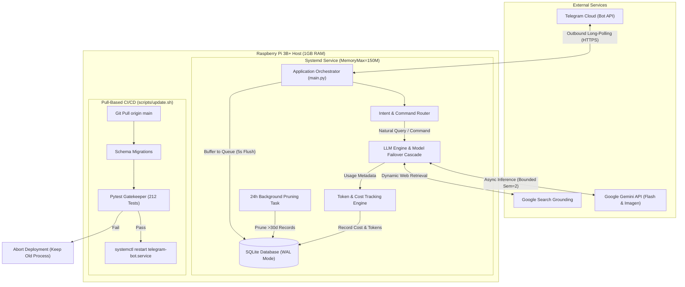
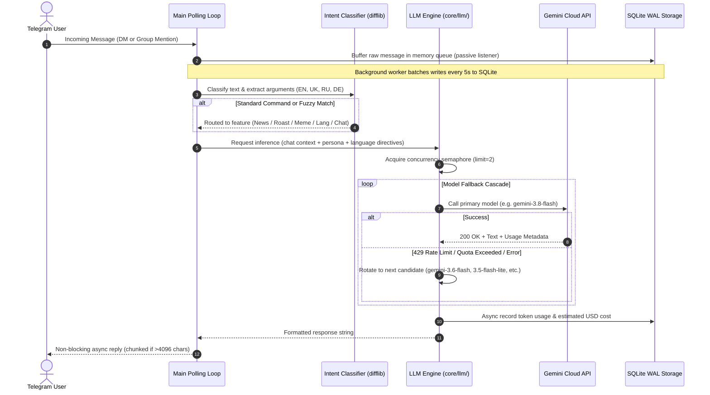

# Edge-Optimized AI Telegram Bot

A production-grade, asynchronous AI assistant engineered for resource-constrained edge computing environments (Raspberry Pi 3B+). Features multi-model Google Gemini LLM orchestration, live Google Search grounding, multimodal image generation, token-level cost accounting, zero-dependency multilingual localization (EN, UK, RU, DE), bounded concurrency safeguards, micro-batched persistence, an owner-approval access gatekeeper, and an automated test-gated CI/CD pipeline.

---

## Technical Summary for Engineering Portfolios

This project demonstrates the design and deployment of a resilient, full-stack edge AI service operating 24/7 on constrained ARM hardware under strict network isolation. It highlights practical trade-offs in systems programming, asynchronous event loops, LLM cost management, and automated operational pipelines.

### Key Engineering Achievements

- **Edge Resource Optimization:** Engineered to run comfortably inside an active resident footprint of approximately **53 MB RAM** (~5.7% of host capacity on a 1 GB Raspberry Pi 3B+), staying well below the systemd enforcement ceiling of **150 MB RAM**. Zero swap thrashing safeguards MicroSD flash endurance.
- **Asynchronous Event-Driven Core & Concurrency Control:** Fully non-blocking event-driven pipeline leveraging `python-telegram-bot` (v20+ async) and `asyncio`. Heavy file and database interactions run via dedicated worker thread pools (`asyncio.to_thread`). API concurrency is strictly bounded via a global `asyncio.Semaphore` (max 2 parallel calls) and dual-layer rate limiting (`RateLimiter` and `AIORateLimiter`) to prevent CPU thrashing and memory spikes during heavy traffic.
- **Multi-Model LLM Resilience & Cascading Failover:** Built on the official `google-genai` SDK with an automated fallback cascade across multiple Gemini Flash models (`gemini-3.8-flash`, `gemini-3.6-flash`, `gemini-3.5-flash-lite`, and latest aliases) to smoothly handle rate limits, transient provider errors, and quota exhaustion without user disruption.
- **Multimodal Generation ("Nano Banana" Engine):** Dynamic image generation and editing using Google's lightweight image models (`gemini-3.1-flash-lite-image`, `gemini-2.5-flash-image`, `gemini-3-pro-image`) with automatic priority failover ordered from lowest to highest per-image cost.
- **Search Grounding with Automatic Degradation:** Integrates real-time Google Search Grounding for dynamic news digests. Dynamically detects API quota exhaustion (HTTP 429) and falls back cleanly to internal knowledge synthesis without crashing.
- **Multilingual Domain & UI Localization:** Zero-dependency per-chat language customization across 4 languages (English, Ukrainian, Russian, German). Features dynamic prompt engineering (`LANGUAGE_DIRECTIVES`) and a static string dictionary (`core/languages.py`) for UI strings, command guides, and fallback notices (<10 KB RAM).
- **FinOps & Google Cloud Telemetry:** Combines local SQLite token tracking with official server-side Google Cloud metrics via direct lightweight REST API endpoints (`core/gcp`). Invoiced month-to-date dollar expenditures are queried from BigQuery Billing Export, and real-time request velocities are retrieved from Cloud Monitoring API, keeping the entire process under a lean memory footprint (< 60 MB RAM). Exposes live financial telemetry and model tracking via an owner-only `/stats` command.
- **Approval-Gated Access Control:** The bot operates under an explicit owner-approval policy to protect API quotas. Users in direct messages and new group chats must be approved by the bot administrator before interaction is enabled. The gatekeeper (`modules/access_control.py`) intercepts unapproved requests at priority group -1, routes interactive approval alerts with inline buttons to the owner, and maintains sub-microsecond in-memory caching for approved entities.
- **Low-Overhead Persistent Storage & Batched Ingestion:** Local persistence utilizing Write-Ahead Logging (`PRAGMA journal_mode = WAL`) paired with an asynchronous in-memory message buffer (`asyncio.Queue` in `modules/listener.py`). Commits chat history in 5-second batches to eliminate SQLite lock contention and extend MicroSD write lifespan. Includes a non-blocking 24-hour background task that prunes records past the 30-day retention window.
- **Strict Dorm Firewall Traversal:** Runs behind an isolated university campus network with inbound client isolation. All traffic operates over outbound HTTPS long-polling (`Application.run_polling()`). Remote administration is conducted securely via a private Tailscale Mesh VPN.
- **Test-Gated Pull-Based CI/CD:** Production updates trigger a two-tier pull-based deployment pipeline (`scripts/update.sh` -> `scripts/deploy.sh`) equipped with a bash `ERR` trap. Before reloading the systemd service, the entire test suite (212 unit tests with 100% offline mocking) must pass, guaranteeing zero-downtime regression prevention.

---

## Architectural Overview



### Request Flow and Fallback Logic



---

## Technical Specifications & Performance Metrics

| Dimension | Specification / Metric | Engineering Rationale |
| :--- | :--- | :--- |
| **Target Hardware** | Raspberry Pi 3B+ (Quad-core ARM Cortex-A53 @ 1.4 GHz, 1 GB RAM) | Extreme edge compute baseline; validates efficiency. |
| **Operating System** | Debian GNU/Linux (Bookworm) 64-bit / Raspberry Pi OS Lite | Headless minimal installation; no X11 or desktop overhead. |
| **Process Memory (RSS)** | **~53 MB** resident memory (~5.7% of system RAM) | Handcrafted light imports; zero bulky runtime dependencies. |
| **Enforced Memory Ceiling**| `MemoryMax=150M`, `MemoryHigh=120M` (via systemd cgroups) | Guarantees the OS and kernel never experience OOM panics. |
| **Swap Usage** | **0 MB** (Zero swap utilization) | Protects MicroSD card against flash endurance degradation. |
| **CPU Usage** | < 1% idle, < 15% peak during active generation | Offloads compute-heavy inference to cloud API via async I/O. |
| **Database Engine** | SQLite 3 (`bot_memory.db`) with Write-Ahead Logging (`WAL`) | Near-zero RAM footprint, crash-resilient, concurrent readers. |
| **Storage Footprint** | ~30 MB application + virtual environment | Fits easily within constrained SD storage allocations. |
| **Unit Test Coverage** | **212 automated test cases** (100% offline mocked, ~2.0s execution) | Tests business logic, error traps, DB concurrency, rate limiting, and LLM retry cascades. |
| **Network Architecture** | Long-polling outbound HTTPS (Telegram API) + Tailscale Mesh VPN | Bypasses dorm NAT firewalls without port forwarding or webhooks. |

---

## Core Capabilities & Features

### 1. Conversational AI with Group Context
- In direct messages, the bot responds to all prompts. In group chats, it enforces strict group privacy by responding only when explicitly mentioned (`@bot_username`) or directly replied to.
- **Owner Approval Required:** The bot operates on a private access model. Any user can initiate contact, but they can converse with the bot and invoke AI commands only upon explicit approval from the bot owner.
- Automatically fetches recent conversation history from SQLite to maintain contextual continuity across exchanges.
- Output is formatted with safe HTML escaping and split into sub-4096-character segments if responses exceed Telegram's single-message limit.

### 2. Multi-Tier Model Fallback Cascade
- Primary requests target modern Flash tier models (`gemini-3.8-flash`).
- If Google returns an HTTP 429 (rate limit exceeded), 503 (service unavailable), or quota error, the request automatically falls back sequentially across candidate models (`gemini-3.6-flash`, `gemini-3.5-flash-lite`, `gemini-flash-latest`, `gemini-flash-lite-latest`).
- Transparent to the end user: the bot indicates the active generating model in the response footer without crashing.

### 3. Generative Visuals and Memes (`/meme`)
- Generates custom illustrations and meme visuals based on text descriptions.
- Leverages Google DeepMind's "Nano Banana" image series (`gemini-3.1-flash-lite-image`, `gemini-2.5-flash-image`, `gemini-3.1-flash-image`, `gemini-3-pro-image`).
- Implements price-ordered model rotation to protect API expenses.

### 4. Search-Grounded News Digest (`/news`)
- Synthesizes up-to-the-minute briefings on global or targeted topics using Google Search Grounding.
- Automatically formats sources and references.
- Features dynamic quota detection: if search tool quotas are exhausted on a free-tier key, it gracefully disables grounding and synthesizes an internal overview instead of throwing an unhandled exception.

### 5. Context-Aware Standup Roasts (`/roast`)
- Queries SQLite for recent messages authored by a targeted user in the current group.
- Constructs an analytical prompt to generate friendly, standup-style comedic roasts based on genuine group conversation dynamics.

### 6. Zero-Dependency Fuzzy Intent Classification
- Recognizes conversational intent across English, Ukrainian, Russian, and German (e.g., "roast", "witze", "просмаж", "новости", "мем").
- Employs Python's standard library `difflib.get_close_matches` with normalized fuzzy matching.
- Users can trigger bot capabilities organically in conversation without memorizing rigid slash command syntax.

### 7. Real-Time Token Telemetry & FinOps (`/stats`)
- Combines local SQLite telemetry with official Google Cloud Platform server-side metrics (`core/gcp`).
- **Model Tracking:** Displays default text model (`gemini-3.8-flash`), default image model (`gemini-3.1-flash-lite-image`), and the most recently utilized model.
- **Official Invoiced Spend:** Queries Google Cloud Billing Export tables via BigQuery REST API to display real-time month-to-date (MTD) dollar costs.
- **Live Velocity:** Retrieves 10-minute trailing request velocity from the Cloud Monitoring API.
- **Zero-SDK Architecture:** Avoids heavy multi-hundred-megabyte client SDKs by executing direct REST queries via `httpx` and `google-auth`, keeping memory usage under 60 MB RAM.
- Restricted strictly to the bot administrator (`ADMIN_CHAT_ID`).

### 8. Manual Gatekeeper & Owner Approval Model (`/approve`, `/reject`, `/access`)
- **Permission Policy:** Access to bot functionality is strictly approval-based. Users and group chats can talk to the bot and execute AI actions only upon explicit administrator authorization.
- **Interactive Approval Flow:** When an unauthorized user attempts to chat or mentions the bot in an unapproved group, the bot sends an immediate Telegram alert to the owner (`ADMIN_CHAT_ID`) containing the requestor's details alongside interactive `[Схвалити]` (Approve) and `[Відхилити]` (Reject) inline buttons.
- **One-Tap Verification:** The administrator can grant instant access with a single button click, or manually manage approvals via `/approve <id>`, `/reject <id>`, and `/access`.
- **Hybrid Scoping:** Authorizes entire group chats at once (enabling all members of an approved group to interact) and individual users for direct messages.
- **Sub-Microsecond Latency:** Approved entities are cached in an in-memory set (`_APPROVED_CACHE`) backed by SQLite (`access_grants` table), guaranteeing zero overhead during normal conversation.

### 9. Dynamic Persona Customization (`/persona`)
- Customizes conversational tone and demeanor (e.g., standard assistant, sarcastic "Meme Lord") via interactive Telegram inline keyboards or direct command arguments.
- User preferences persist in SQLite (`user_personas` table) and dynamically format system prompts for conversations, roasts, and image generation.
- Operates with zero memory overhead using Python dictionary lookups and isolated database storage.

### 10. AI-Driven Emotional Reactions (`/switch_reaction`)
- Uses ultra-lightweight models (`gemini-3.5-flash-lite`) to evaluate incoming chat context and attach relevant Telegram emoji reactions.
- Controlled via an administrator-only toggle per chat (`/switch_reaction [chat_id]`) persisted in SQLite (`chat_reaction_settings`) to prevent spam and protect API quotas.
- Runs non-blockingly without delaying the primary message processing loop.

### 11. Multilingual Localization & Chat Language Selection (`/lang`)
- Full per-chat language customization supporting 4 languages: English (`en`), Ukrainian (`uk`), Russian (`ru`), and German (`de`).
- Settings persist per chat in SQLite (`chat_languages` table via `core/database/languages.py`).
- Interactive inline button menus (`/lang` and during `/start` onboarding) update preferences in real time with dynamic message re-rendering.
- Dynamic prompt engineering: automatically injects language constraints (`LANGUAGE_DIRECTIVES`) into Gemini system instructions, ensuring AI replies strictly honor the chat's chosen language.
- Zero-dependency static string dictionary (`core/languages.py`) localizes UI greetings, command guides, rate limit warnings, and fallback messages with minimal memory footprint (<10 KB RAM).

### 12. Dual-Layer Rate Limiting & Concurrency Control
- **Application Rate Limiter (`core/rate_limiter.py`):** Enforces a 5-second cooldown per user and limits simultaneous active generations to 3 per chat, preventing group flood thrashing.
- **Global LLM Semaphore (`core/llm/concurrency.py`):** Strict singleton `asyncio.Semaphore` (limit=2) caps simultaneous Gemini API executions across the entire process, safeguarding Raspberry Pi 3B+ CPU and memory limits during burst activity.
- **Outbound Telegram Throttling:** Built with `python-telegram-bot`'s `AIORateLimiter` and `concurrent_updates(True)` to smooth out bursts and prevent Telegram HTTP 429 penalties.
- **Periodic Memory Cleanup:** Automatically prunes inactive user timestamps every 50 checks to maintain resident RAM overhead under 100 KB.

### 13. Group Onboarding & Scoped Command Autocomplete
- Chat member update listener (`ChatMemberHandler`) detects when the bot is invited into a new group, welcoming members in English and providing immediate inline language selection buttons.
- Dynamic command registration: automatically registers bot descriptions and autocompletion lists with Telegram Bot API, cleanly separating public commands from administrator-only management commands.

### Command Directory

| Command | Scope | Description |
| :--- | :--- | :--- |
| `/start` | Public | Bot onboarding greeting with interactive language selection keyboard |
| `/help` | Public | Command guide and capabilities directory in chat's active language |
| `/ping` | Public | Instant event loop responsiveness verification |
| `/lang` | Public | Select active chat communication language (EN, UK, RU, DE) |
| `/persona` | Public | Choose persona style (Default, Sarcastic Meme Lord, etc.) |
| `/news [topic]` | Public | Live news briefing synthesized via Google Search Grounding |
| `/roast <@user>` | Public | Context-aware comedy roast based on recent chat history |
| `/meme <prompt>` | Public | AI illustration generation via Nano Banana image models |
| `/stats` | Admin | Token telemetry, BigQuery spend, and Cloud Monitoring velocity |
| `/access` | Admin | View pending and approved access grants |
| `/approve <id>` | Admin | Whitelist a user ID or group chat |
| `/reject <id>` | Admin | Revoke access permissions for a user or group |
| `/switch_reaction` | Admin | Toggle autonomous AI emoji reactions for a chat |

---

## Getting Started

### Prerequisites
- Python 3.11 or newer
- Git
- Valid Telegram Bot Token (obtained from [@BotFather](https://t.me/botfather))
- Google Gemini API Key (obtained from [Google AI Studio](https://aistudio.google.com/))

### 1. Clone the Repository
```bash
git clone https://github.com/<username>/pi-telegram-chat-bot.git
cd pi-telegram-chat-bot
```

### 2. Set Up Virtual Environment
```bash
python -m venv venv

# On Linux / macOS:
source venv/bin/activate

# On Windows PowerShell:
.\venv\Scripts\Activate.ps1
```

### 3. Install Pinned Dependencies
```bash
pip install -r requirements.txt
```

### 4. Configure Environment Variables
Copy the template and configure your secrets:
```bash
cp .env.example .env
```

Edit `.env` with your preferred settings:
```ini
# Telegram Credentials
TELEGRAM_BOT_TOKEN=your_telegram_bot_token_here
ADMIN_CHAT_ID=your_numeric_chat_id_here

# LLM Credentials
GEMINI_API_KEY=your_gemini_api_key_here

# Runtime Parameters
LOG_LEVEL=INFO
LOG_TO_CONSOLE=true
LOG_TO_FILE=true
LOG_FILE_PATH=bot.log
DATABASE_PATH=bot_memory.db

# Google Cloud Platform (FinOps & Telemetry)
GCP_PROJECT_ID=your-project-id
GCP_SERVICE_ACCOUNT_FILE=gcp_service_account.json
GCP_BILLING_TABLE=your_dataset.gcp_billing_export_v1_XXXXXX_XXXXXX_XXXXXX
```

### 5. Execute Offline Unit Tests
Run the comprehensive test suite to confirm complete local readiness:
```bash
pytest
```
*Expected: 212 passed tests in approximately 2 seconds.*

### 6. Run the Application
```bash
python main.py
```

---

## Automated Deployment & Production CI/CD

Production runs as an isolated `systemd` service on the Raspberry Pi edge device. Deployments utilize a two-tier pull-based architecture (`scripts/update.sh` -> `scripts/deploy.sh`) that eliminates self-modification hazards and guarantees zero-downtime regression protection.

```bash
# Pulls from Git and executes deployment sequence
bash scripts/update.sh

# Or run deployment sequence directly without pulling from Git
bash scripts/deploy.sh
```

### Deployment Pipeline Workflow (`scripts/update.sh` -> `scripts/deploy.sh`)

1. **Repository Synchronization:** Pulls incoming commits from `origin/main`.
2. **Virtual Environment Isolation:** Activates the application's isolated `venv/` environment.
3. **Dependency Sync:** Installs updated pinned packages via `pip install --no-input -r requirements.txt`.
4. **Database Migration:** Executes idempotent schema initialization (`python -c "from core.database import init_db; init_db()"`).
5. **Quality Gatekeeper:** Runs `pytest`. If any unit test fails, the bash `ERR` trap catches the exit code and aborts the entire execution before touching the running service.
6. **Graceful Reload:** If and only if all tests pass, the script executes `sudo systemctl restart telegram-bot.service`.

### Systemd Service Configuration

The service is sandboxed using systemd cgroups to strictly enforce resource boundaries:

```ini
[Unit]
Description=Raspberry Pi Telegram Bot (Production)
After=network.target network-online.target
Wants=network-online.target

[Service]
Type=simple
User=<username>
WorkingDirectory=/home/<username>/pi-telegram-chat-bot
EnvironmentFile=/home/<username>/pi-telegram-chat-bot/.env
ExecStart=/home/<username>/pi-telegram-chat-bot/venv/bin/python main.py
Restart=always
RestartSec=10
TimeoutStopSec=15
StandardOutput=journal
StandardError=journal
SyslogIdentifier=telegram-bot

# Cgroup Resource Ceilings for Raspberry Pi 3B+
MemoryMax=150M
MemoryHigh=120M
CPUQuota=80%

[Install]
WantedBy=multi-user.target
```

### Useful Management Commands
```bash
# Check service status, active PID, and resident memory usage
systemctl status telegram-bot.service

# View live streamed production logs
journalctl -u telegram-bot.service -f -n 50

# Restart the service manually
sudo systemctl restart telegram-bot.service
```

---

## Dual-Environment Isolation

To eliminate Telegram `409 Conflict` errors caused by concurrent long-polling loops against a shared token, development and production operate in total isolation:

| Environment | Host System | Execution Model | Bot Token | Database Target |
| :--- | :--- | :--- | :--- | :--- |
| **Development** | Local Workstation | On-demand (`python main.py`) | Dev Bot Token | `bot_data.db` |
| **Production** | Raspberry Pi 3B+ (Edge Server) | Systemd daemon (24/7) | Prod Bot Token | `bot_memory.db` |

---

## Testing Strategy

- **Unit Testing (212 tests):** All components (database queries, logging, intent parsing, error handling, token math, command routing, multilingual directives, concurrency semaphores) are tested offline with zero external network calls. Telegram and Gemini APIs are fully mocked with `unittest.mock`, validating regression resilience in approximately 2 seconds before any service reload.