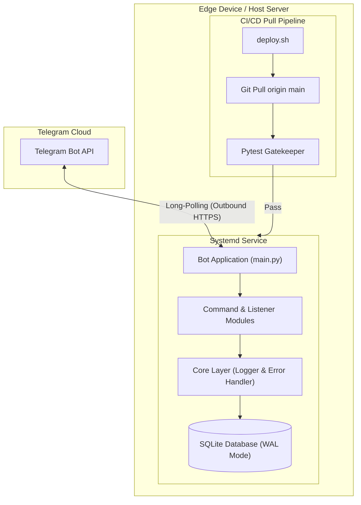
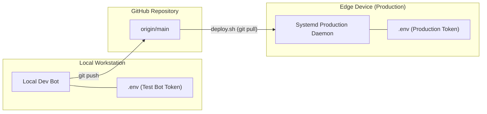

# Edge-Optimized Telegram Bot

A lightweight, asynchronous Telegram bot built with `python-telegram-bot` (v20+) engineered specifically for resource-constrained edge computing environments such as the Raspberry Pi 3B+.

Designed with an ultra-lean memory footprint, the application maintains a strict memory budget under 150 MB RAM, achieves zero swap utilization, operates safely behind restricted networks using Telegram long-polling, and incorporates an automated test-gated CI/CD pull workflow.

---

## Architecture Overview



### System Design Principles

1. **Strict Memory Budget:** Engineered for edge devices with 1 GB total system RAM. The application maintains an active footprint of approximately 50-60 MB RAM, well beneath the 150 MB hard limit.
2. **Zero Swap Usage:** Eliminates swap thrashing to safeguard flash storage (MicroSD cards) against I/O bottlenecks and write degradation.
3. **Firewall & NAT Agnostic:** Operates via outbound long-polling exclusively. No open ports, reverse proxies, or inbound webhooks required.
4. **Local WAL Persistence:** SQLite operates in Write-Ahead Logging (WAL) mode for low-overhead concurrency and resilience against power loss.
5. **Quality-Gated Deployment:** Production deployments automatically execute unit test suites before reloading the service.

---

## Project Structure

```text
pi-telegram-chat-bot/
├── core/
│   ├── db.py               # Asynchronous SQLite operations with WAL configuration
│   ├── error_handler.py    # Global uncaught exception and error reporter
│   └── logger.py           # Rotating file logger capped at 6 MB total disk usage
├── modules/
│   ├── analytics.py        # Usage statistics and interaction metrics
│   ├── commands.py         # Primary bot command handlers and autocomplete registration
│   └── listener.py         # Passive message recording and incoming event hooks
├── systemd/
│   └── telegram-bot.service # Production daemon unit template for systemd
├── tests/
│   ├── test_commands.py    # Unit tests for bot command routing and responses
│   ├── test_db.py          # Unit tests for SQLite concurrency and table initialization
│   ├── test_error_handler.py# Unit tests for error handling logic
│   └── test_logger.py      # Unit tests for log rotation and formatters
├── .env.example            # Environment configuration template
├── deploy.sh               # Pull-based deployment pipeline with pytest gatekeeper
├── main.py                 # Application bootstrap and runtime orchestrator
├── requirements.txt        # Pinned production dependencies
└── README.md               # Public project documentation
```

---

## Environment Separation

The codebase follows a dual-environment strategy to avoid polling collisions (`409 Conflict` errors):



- **Local Development:** Run on demand on a workstation with a designated test bot token for immediate feedback.
- **Production Server:** Runs 24/7 as a managed systemd background service on the edge device with the production token.

---

## Getting Started

### Prerequisites
- Python 3.11+
- Git

### 1. Clone the Repository
```bash
git clone https://github.com/<username>/pi-telegram-chat-bot.git
cd pi-telegram-chat-bot
```

### 2. Configure Environment
Copy the template and supply your credentials:
```bash
cp .env.example .env
```

Configure the following variables in `.env`:
```ini
# Telegram Credentials
TELEGRAM_BOT_TOKEN=your_bot_token_here
ADMIN_CHAT_ID=your_chat_id_here

# LLM Credentials
GEMINI_TOKEN_KEY=your_api_key_here

# Runtime Configuration
LOG_LEVEL=INFO
LOG_TO_CONSOLE=true
LOG_TO_FILE=true
LOG_FILE_PATH=bot.log
DATABASE_PATH=bot_memory.db
```

### 3. Setup Virtual Environment
```bash
python -m venv venv

# On Linux / macOS:
source venv/bin/activate

# On Windows PowerShell:
.\venv\Scripts\Activate.ps1

pip install -r requirements.txt
```

### 4. Run the Test Suite
All tests run offline using mocks without contacting external APIs:
```bash
pytest
```

### 5. Launch the Bot Locally
```bash
python main.py
```

---

## Production Deployment

### Automated Pull Deployment (`deploy.sh`)

Deployments utilize a pull-based bash script that guarantees zero-downtime regression protection.

```bash
bash deploy.sh
```

The script executes this automated workflow:
1. **Pull:** Fetches the latest commits from `origin/main`.
2. **Environment:** Activates the local virtual environment.
3. **Dependencies:** Non-interactively installs updated requirements.
4. **Migrations:** Runs database schema initialization.
5. **Gatekeeper:** Runs `pytest`. If any unit test fails, execution aborts immediately via a bash `ERR` trap, preventing the running service from being restarted with faulty code.
6. **Reload:** Restarts `telegram-bot.service` only when all tests pass.

### Systemd Integration

For 24/7 background execution on Linux:

1. Copy the unit file into systemd:
   ```bash
   sudo cp systemd/telegram-bot.service /etc/systemd/system/
   ```
2. Reload systemd daemon:
   ```bash
   sudo systemctl daemon-reload
   ```
3. Enable and start the service:
   ```bash
   sudo systemctl enable --now telegram-bot.service
   ```
4. Verify service status:
   ```bash
   systemctl status telegram-bot.service
   ```

---

## License

This project is licensed under the MIT License.